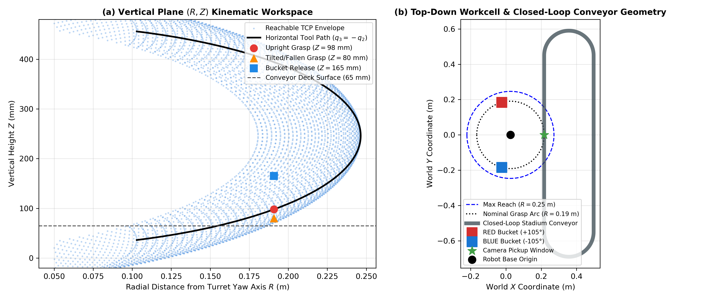
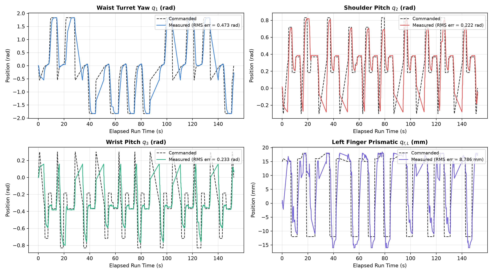
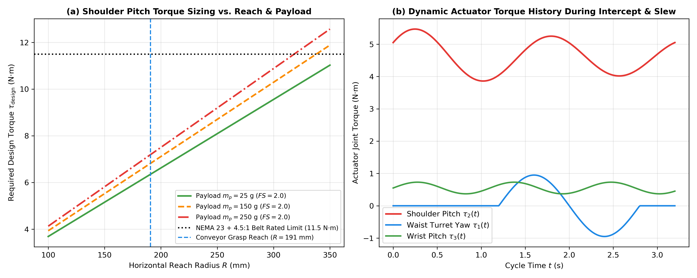
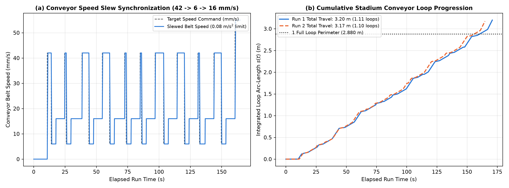
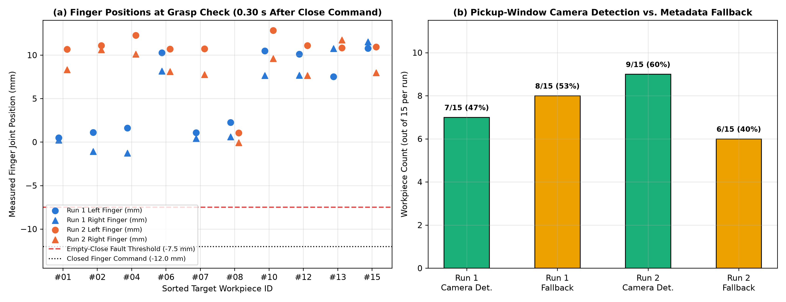
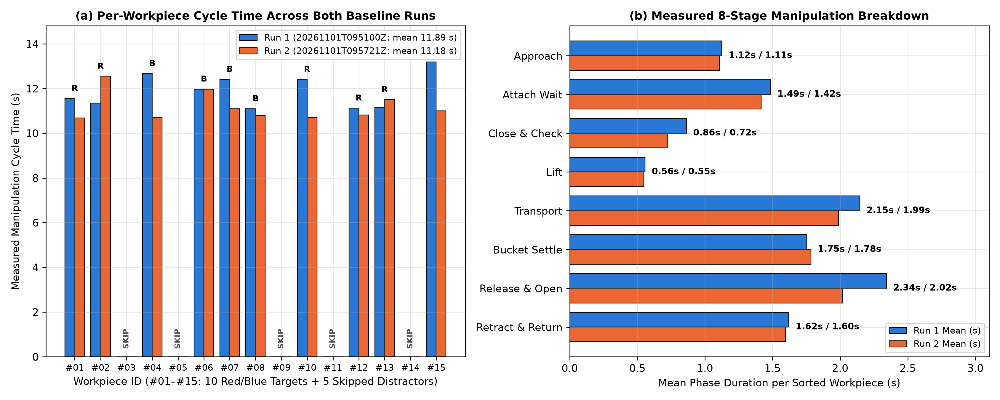

# Vision-Guided 4-DOF Robotic Sorting Cell with Moving-Conveyor Interception

[](https://github.com/Samarth-Amin/4-dof-robotic-arm-ros2-gazebo-color-sorting/actions/workflows/repository-validation.yml)

**ROS 2 Jazzy · Gazebo Harmonic · SolidWorks · URDF/Xacro · Python · RGB Colour Segmentation · Constrained-Pose Analytical IK · Quintic Trajectories**

**Author:** Samarth Amin (`23bme005@nirmauni.ac.in`)  
**Discipline:** B.Tech Mechanical Engineering (Minor in Software Engineering), Nirma University

A simulation-based robotic manufacturing workcell combining a custom SolidWorks-derived **4-DOF revolute manipulator**, a **2-axis parallel gripper**, a continuously circulating **15-carrier stadium conveyor**, RGB channel-dominance workpiece classification, and **model-synchronised moving-object interception**.

---

## Highlights & Measured 2-Run Baseline Summary

* **Mechanical & Simulation Architecture:** SolidWorks-derived 4-DOF arm (`joint_1` waist yaw, `joint_2` shoulder pitch, `joint_3` wrist pitch, `joint_4` wrist roll) and two prismatic gripper fingers (`finger_left_joint`, `finger_right_joint`), integrated with a 15-carrier closed-loop stadium conveyor ($P_{\mathrm{loop}} = 2.8796\text{ m}$) in ROS 2 Jazzy and Gazebo Harmonic.
* **Moving-Conveyor Interception & Control:** Closed-form constrained-pose inverse kinematics ($q_3 = -q_2$), $60\text{ Hz}$ fifth-order quintic time-scaled trajectories, and slewed belt-speed synchronisation ($42 \rightarrow 6 \rightarrow 16\text{ mm/s}$ with $0.08\text{ m/s}^2$ acceleration limiting).
* **Telemetry & Reproducible Audit Pipeline:** Automated per-run telemetry recorder logging `run_summary.json`, `phase_events.csv`, `motion_tracking.csv`, `joint_state_telemetry.csv`, and `conveyor_path_commands.csv` under `data/audits/`, paired with `tools/analyze_audit.py` and CI static consistency checks.
* **Measured 2-Run Baseline (`20261101T095100Z` & `20261101T095721Z`):**
  * **Target Sorting Completion:** `10 / 10` target workpieces (`5 RED`, `5 BLUE`) completed the full pick, transport, drop-pose arrival (within $\le 0.033\text{ rad}$), and release-confirmation sequence in both runs (`20 / 20` total).
  * **Distractor Rejection:** `5 / 5` non-target workpieces (`YELLOW`, `PURPLE`, `ORANGE`, `CYAN`, `GREEN`) skipped in both runs (`10 / 10` total).
  * **Measured Manipulation Cycle Time:** Mean **`11.89 s`** ($\pm 0.75\text{ s}$, range $11.10\text{–}13.19\text{ s}$) in Run 1 and **`11.18 s`** ($\pm 0.63\text{ s}$, range $10.69\text{–}12.55\text{ s}$) in Run 2.
  * **Documented Baseline Scope:** Transport uses Gazebo's `DetachableJoint` attachment constraint; camera detection fired on $7/15$ windows in Run 1 ($47\%$) and $9/15$ in Run 2 ($60\%$) with $100\%$ colour agreement when detected and metadata fallback on remaining windows.

---

## Visual Demonstration

* **Simulation Video:** 


https://github.com/user-attachments/assets/5375b9ef-bf01-4026-981f-5741450c76a7




---

## 1. Project Overview

This repository implements an end-to-end CAD-to-ROS 2 simulation and validation workflow for a belt-and-bevel-driven robotic manipulator operating over a closed-loop stadium conveyor. Rather than executing fixed point-to-point picks on stationary objects, the controller coordinates:
1. **Continuous Conveyor Circulation:** 15 workpieces circulate around a $2.8796\text{ m}$ stadium loop in arrival order. Ten are target blocks (`5 RED`, `5 BLUE`) arranged in uneven clusters, and five are distractors (`YELLOW`, `PURPLE`, `ORANGE`, `CYAN`, `GREEN`).
2. **Hybrid Vision & Model-Tracked Interception:** An overhead RGB camera classifies workpiece colours in the pickup window, while horizontal pickup coordinates track the carrier puck's parametric path coordinate $s(t)$.
3. **Full Telemetry Auditing:** Every run records joint tracking errors, phase durations, attach/detach service latencies, and conveyor kinematics to `data/audits/`.

---

## 2. Workcell Architecture & Calibrated Configuration

All geometric parameters are verified across `config/kinematics_config.json`, `urdf/jork_arm.urdf.xacro`, and `worlds/sorting_cell.sdf` by `scripts/check_project_consistency.py`:

| Parameter | Configuration Key | Calibrated Value |
| :--- | :--- | :--- |
| **Turret Yaw Axis Origin $(x_0, y_0)$** | `x0`, `y0` | $(0.0258,\; 0.0000)\text{ m}$ |
| **Shoulder Pitch Offset $(j_{2x}, Z_{\mathrm{shoulder}})$** | `j2_x`, `Z_shoulder` | $(-0.0581,\; 0.2581)\text{ m}$ |
| **Upper Arm Beam Length ($L_2$)** | `L2` | $0.2250\text{ m}$ |
| **Gripper Pad Offset $(X_{\mathrm{pad}}, Z_{\mathrm{pad}})$** | `X_pad`, `Z_pad` | $(0.0795,\; -0.0120)\text{ m}$ |
| **Nominal Grasp Reach ($R_{\mathrm{grasp}}$)** | `R_grasp` | $0.1908\text{ m}$ |
| **Grasp Heights ($Z_{\mathrm{upright}}, Z_{\mathrm{fallen}}$)** | `Z_grasp_upright`, `Z_grasp_fallen` | $0.0980\text{ m},\; 0.0800\text{ m}$ |
| **Overhead Camera Pose $(X, Y, Z, \mathrm{FOV}_h)$** | `cam_x`, `cam_y`, `cam_z`, `fov_h` | $(0.2166,\; 0.0000,\; 0.7200)\text{ m},\; 0.70\text{ rad}$ |
| **Active Conveyor Lane Center $(X_{\mathrm{belt}}, Y_{\mathrm{belt}})$** | `belt_x`, `belt_y` | $(0.2166,\; 0.0000)\text{ m}$ |
| **Straight Lane Bounds ($Y_{\mathrm{rear}}, Y_{\mathrm{front}}$)** | `y_rear`, `y_front` | $[-0.5500,\; +0.4500]\text{ m}$ ($L_{\mathrm{straight}} = 1.00\text{ m}$) |
| **Turnaround Drum Radius & Loop Perimeter** | `R_loop`, `P_loop` | $R_{\mathrm{loop}} = 0.1400\text{ m},\; P_{\mathrm{loop}} = 2.8796\text{ m}$ |
| **Sorting Bucket Centers (`RED`, `BLUE`)** | `buckets` | $\mathrm{RED}: (-0.0235, +0.1843, 0.1750)\text{ m}$, $\mathrm{BLUE}: (-0.0235, -0.1843, 0.1750)\text{ m}$ |

---

## 3. Mechanical Design and Kinematics

### Manipulator DOF Accounting & Modified DH Table
The URDF (`urdf/jork_arm.urdf.xacro`) models **4 independent revolute manipulator joints** (`joint_1` through `joint_4`) and **2 prismatic gripper finger joints** (`finger_left_joint`, `finger_right_joint`):

| Joint $i$ | URDF Joint Name | Parent $\rightarrow$ Child Link | Axis | Origin $(X, Y, Z)$ (m) | $\theta_i$ (rad) | $d_i$ (m) | $a_i$ (m) | $\alpha_i$ (rad) | Limits |
| :--- | :--- | :--- | :--- | :--- | :--- | :--- | :--- | :--- | :--- |
| **1** | `joint_1` | `base_link` $\rightarrow$ `link_upright` | $Z_0$ (`0 0 1`) | $(0.0258, 0.0, 0.0800)$ | $q_1$ | $0.0800$ | $-0.0581$ | $-\pi/2$ | $[-\pi, +\pi]\text{ rad}$ |
| **2** | `joint_2` | `link_upright` $\rightarrow$ `link_arm_beam` | $Y_1$ (`0 1 0`) | $(-0.0581, 0.0, 0.1781)$ | $q_2$ | $0.1781$ | $0.2250$ | $0.0000$ | $[-1.20, +1.20]\text{ rad}$ |
| **3** | `joint_3` | `link_arm_beam` $\rightarrow$ `link_wrist` | $Y_2$ (`0 1 0`) | $(0.2250, 0.0, 0.0000)$ | $q_3$ | $0.0000$ | $0.0795$ | $-\pi/2$ | $[-1.57, +1.57]\text{ rad}$ |
| **4** | `joint_4` | `link_wrist` $\rightarrow$ `gripper_base` | $X_3$ (`1 0 0`) | $(0.0000, 0.0, 0.0000)$ | $q_4$ | $0.0000$ | $0.0000$ | $0.0000$ | $[-\pi, +\pi]\text{ rad}$ |
| **Gripper L** | `finger_left_joint` | `gripper_base` $\rightarrow$ `gripper_finger_left` | $+Y_4$ (`0 1 0`) | $(0.0535, +0.016, -0.012)$ | $0.0$ | $q_{f,L}$ | $0.0260$ | $0.0000$ | $[-0.016, +0.018]\text{ m}$ |
| **Gripper R** | `finger_right_joint` | `gripper_base` $\rightarrow$ `gripper_finger_right` | $-Y_4$ (`0 -1 0`) | $(0.0535, -0.016, -0.012)$ | $0.0$ | $q_{f,R}$ | $0.0260$ | $0.0000$ | $[-0.016, +0.018]\text{ m}$ |

### Constrained-Pose Analytical Inverse Kinematics
Keeping the gripper horizontal ($q_3 = -q_2$), the closed-form constrained-pose inverse kinematics equations are:

$$q_1 = \operatorname{atan2}(Y - y_0,\; X - x_0), \qquad q_2 = \arcsin\!\left(\operatorname{clip}\!\left(\frac{Z_{\mathrm{shoulder}} + Z_{\mathrm{pad}} - Z_{\mathrm{TCP}}}{L_2},\; -0.85,\; +0.85\right)\right), \qquad q_3 = -q_2$$

---

## 4. Trajectory Generation and Joint Tracking Telemetry

Point-to-point moves are interpolated at $60\text{ Hz}$ using a fifth-order quintic polynomial $s(\tau) = 10\tau^3 - 15\tau^4 + 6\tau^5$. During `move_puck_tracked()`, the controller recomputes `solve_ik(px, py, z_now)` at each $60\text{ Hz}$ tick as the carrier moves along the loop.



### Measured Joint Tracking Error Summary (2 Baseline Runs)

| Joint Name | Run 1 RMS Error | Run 1 Max Abs Error | Run 2 RMS Error | Run 2 Max Abs Error | Primary Source of Peak Lag |
| :--- | :--- | :--- | :--- | :--- | :--- |
| **`joint_1` (Waist Yaw)** | $0.473\text{ rad}$ | $2.062\text{ rad}$ | $0.473\text{ rad}$ | $1.986\text{ rad}$ | Large-angle slews ($\pm 1.83\text{ rad}$) between conveyor and buckets |
| **`joint_2` (Shoulder Pitch)** | $0.210\text{ rad}$ | $0.574\text{ rad}$ | $0.222\text{ rad}$ | $0.635\text{ rad}$ | Step transition at start of tracked approach descent |
| **`joint_3` (Wrist Pitch)** | $0.220\text{ rad}$ | $0.583\text{ rad}$ | $0.233\text{ rad}$ | $0.617\text{ rad}$ | Coupled $q_3 = -q_2$ horizontal-leveling tracking |
| **`joint_4` (Wrist Roll)** | $0.026\text{ rad}$ | $0.163\text{ rad}$ | $0.013\text{ rad}$ | $0.102\text{ rad}$ | Minor dynamic coupling during rapid turret slews |
| **`finger_left_joint`** | $7.10\text{ mm}$ | $23.61\text{ mm}$ | $8.79\text{ mm}$ | $26.09\text{ mm}$ | Step command from $+18\text{ mm}$ open to $-12\text{ mm}$ closed |
| **`finger_right_joint`** | $6.70\text{ mm}$ | $24.96\text{ mm}$ | $8.20\text{ mm}$ | $26.94\text{ mm}$ | Step command from $+18\text{ mm}$ open to $-12\text{ mm}$ closed |

---

## 5. Mechanical Torque Sizing

Evaluated from the URDF link inertial parameters (`link_arm_beam` = $1.40\text{ kg}$, `link_wrist` = $0.40\text{ kg}$, `gripper_base` + fingers = $0.59\text{ kg}$) and a $0.25\text{ kg}$ rated payload at peak angular acceleration $\alpha_{\max} = 4.0\text{ rad/s}^2$ and safety factor $FS = 2.0$:

$$\tau_{\mathrm{design}} = FS \left(\tau_{\mathrm{static}} + J_{\mathrm{eff}}\alpha_{\max}\right) = 10.64\text{ N}\cdot\text{m}$$



---

## 6. Conveyor Kinematics and Speed Slew Synchronization

The 15 carrier pucks circulate around the $2.8796\text{ m}$ stadium loop under an acceleration-limited speed profile (`max_slew_rate = 0.08 m/s²`), transitioning smoothly between $42\text{ mm/s}$ (cruise), $6\text{ mm/s}$ (co-moving grasp window), $16\text{ mm/s}$ (bucket transport), and $55\text{ mm/s}$ (end-of-run circulation).



---

## 7. Vision Classification and Grasp / Attachment Mechanics



### Key Findings From the 2-Run Audit Telemetry
1. **Camera Detection Coverage & Colour Agreement:** In Run 1, the camera detected $7/15$ workpieces ($47\%$) in the pickup window and used metadata fallback on $8/15$; in Run 2, it detected $9/15$ ($60\%$) and used fallback on $6/15$. On all $16/16$ camera detections across both runs, the segmented colour matched the carrier puck's ground-truth colour ($100\%$ precision).
2. **Camera-vs-Model Coordinate Offset & Pose Heuristic:** Projected camera $Y$ coordinates differed from the carrier puck model by a mean of $-23.6\text{ mm}$ (Run 1) to $-24.0\text{ mm}$ (Run 2) due to perspective height offset. In addition, the bounding-box pixel-count threshold (`len(xs) > 150`) classified all 16 camera detections as `Tilted/Fallen` ($Z_{\mathrm{grasp}} = 0.080\text{ m}$) even though blocks spawn upright, whereas metadata fallbacks defaulted to `Upright` ($Z_{\mathrm{grasp}} = 0.098\text{ m}$).
3. **`DetachableJoint` Transport & Finger Check Timing:** The controller requests Gazebo's `DetachableJoint` attach at the end of `approach_final_descent` (taking a mean of $1.49\text{ s}$ in Run 1 and $1.42\text{ s}$ in Run 2 to confirm while holding the pose), then commands finger closure to $-12\text{ mm}$ for $0.30\text{ s}$ before reading `/joint_states`. At check time, fingers are still in mid-stroke ($+0.5\text{ to }+11.5\text{ mm}$), and `held = welded` governs transport.

---

## 8. Measured 2-Run Simulation Benchmark



| Benchmark Metric | Run 1 (`20261101T095100Z`) | Run 2 (`20261101T095721Z`) | Combined 2-Run Baseline |
| :--- | :--- | :--- | :--- |
| **Red Target Workpieces Sorted** | `5 / 5 (100%)` | `5 / 5 (100%)` | `10 / 10` release confirmed at drop pose |
| **Blue Target Workpieces Sorted** | `5 / 5 (100%)` | `5 / 5 (100%)` | `10 / 10` release confirmed at drop pose |
| **Distractor Workpieces Skipped** | `5 / 5 (100%)` | `5 / 5 (100%)` | `10 / 10` circulated past pickup window |
| **Mean Target Cycle Time ($\pm$ SD)** | `11.89 s ± 0.75 s` | `11.18 s ± 0.63 s` | `11.54 s` overall mean (`10.69–13.19 s` range) |
| **Mean Attach Confirmation Latency** | `1.49 s ± 0.34 s` | `1.42 s ± 0.24 s` | `1.45 s` mean Gazebo service confirmation |
| **Mean Detach Confirmation Latency** | `1.50 s ± 0.38 s` | `1.30 s ± 0.04 s` | `1.40 s` mean Gazebo service confirmation |
| **Drop-Pose Joint Settling Error** | `0.028 rad mean (≤ 0.033 rad)` | `0.028 rad mean (≤ 0.033 rad)` | `20 / 20` arrivals within $0.06\text{ rad}$ tolerance |
| **Total Run Elapsed Wall Time** | `173.10 s` ($3.20\text{ m}$ belt travel) | `166.57 s` ($3.17\text{ m}$ belt travel) | $1.10\text{–}1.11$ conveyor loops completed |

### Mean 8-Stage Manipulation Duration per Target Workpiece

| Stage # | Manipulation Phase | Run 1 Mean (s) | Run 2 Mean (s) | Share of Cycle (%) |
| :--- | :--- | :--- | :--- | :--- |
| **1** | **Approach (`pre_descent` + `final_descent`)** | `1.12 s` | `1.11 s` | `9.7%` |
| **2** | **Attach Confirmation Wait (`hold_during_attach`)** | `1.49 s` | `1.42 s` | `12.6%` |
| **3** | **Finger Closure & Check (`gripper_close_after_attach`)** | `0.86 s` | `0.72 s` | `6.9%` |
| **4** | **Lift Clear of Cradle (`lift_clear_of_cradle`)** | `0.56 s` | `0.55 s` | `4.8%` |
| **5** | **Transport to Bucket Hover (`transport_to_bucket_hover`)** | `2.15 s` | `1.99 s` | `17.9%` |
| **6** | **Bucket Final Descent & Arrival Settle** | `1.75 s` | `1.78 s` | `15.3%` |
| **7** | **Jaw Opening & Detach Confirmation (`release`)** | `2.34 s` | `2.02 s` | `18.9%` |
| **8** | **Retract & Return to Side-Ready Posture** | `1.62 s` | `1.60 s` | `13.9%` |
| **Total** | **Complete Target Manipulation Cycle** | **`11.89 s`** | **`11.18 s`** | **`100.0%`** |

---

## 9. Repository Structure

```text
4-dof-robotic-arm-ros2-gazebo-color-sorting/
├── README.md
├── docs/
│   └── VALIDATION_REPORT.md             # Claim-by-claim telemetry audit report
├── data/
│   └── audits/
│       ├── 20261101T095100Z/            # Run 1 summary JSON, phase events & gzipped telemetry
│       └── 20261101T095721Z/            # Run 2 summary JSON, phase events & gzipped telemetry
├── media/
│   ├── workspace_envelope.png
│   ├── audit_cycle_breakdown.png
│   ├── audit_joint_tracking.png
│   ├── audit_vision_and_grasp.png
│   ├── audit_conveyor_kinematics.png
│   ├── quintic_trajectories.png
│   └── torque_analysis.png
├── tools/
│   └── analyze_audit.py                 # Reproducible telemetry parser & figure generator
└── src/
    └── jork_arm_description/
        ├── CMakeLists.txt
        ├── package.xml
        ├── config/kinematics_config.json
        ├── launch/
        │   ├── display.launch.py
        │   └── gazebo.launch.py
        ├── meshes/                      # 7 SolidWorks-exported STL subassemblies
        ├── rviz/view_arm.rviz
        ├── scripts/
        │   ├── check_project_consistency.py
        │   ├── pick_and_place_demo.py
        │   └── vision_sorting_cell.py
        ├── urdf/jork_arm.urdf.xacro
        └── worlds/sorting_cell.sdf
