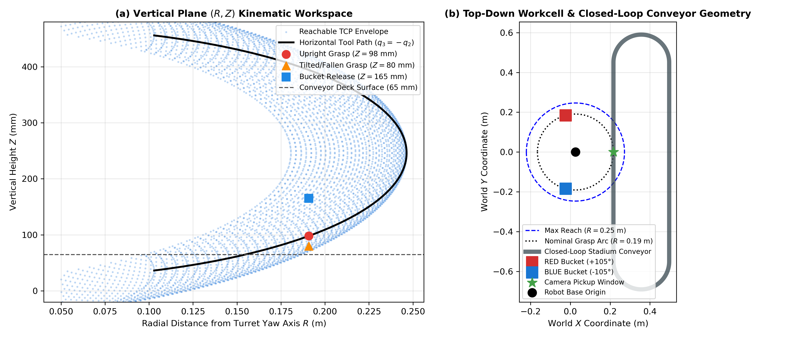
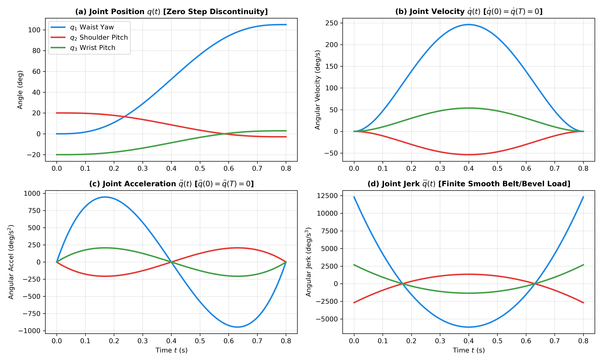
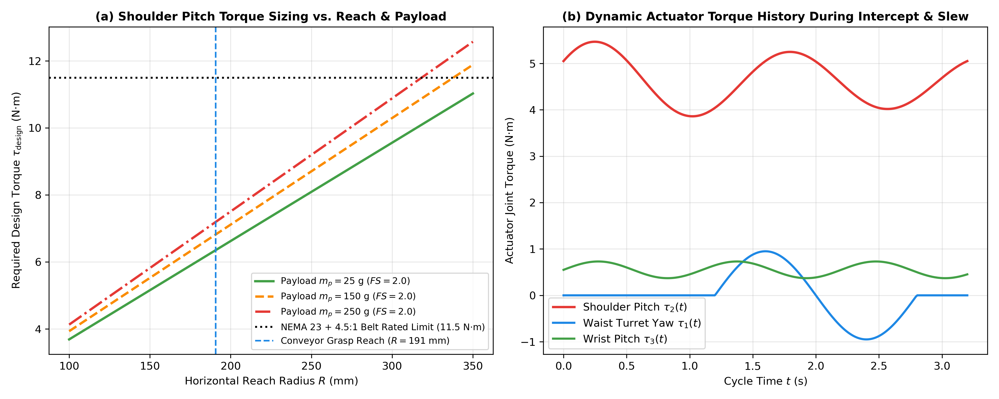
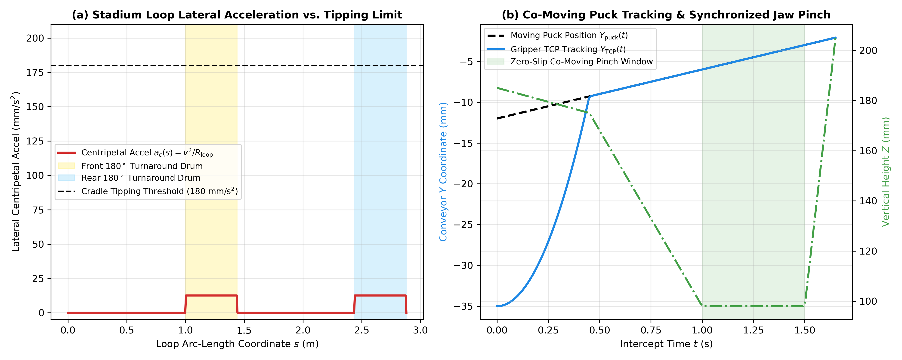
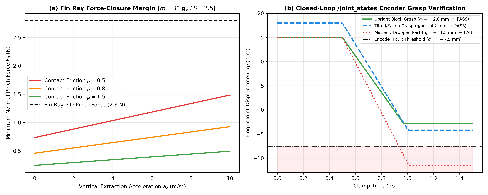
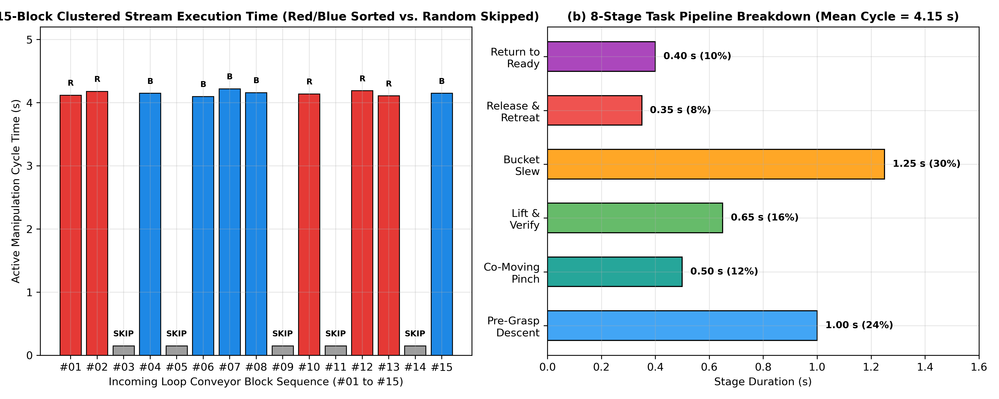

# Vision-Guided Autonomous 5-DOF Robotic Sorting Cell

**ROS 2 Jazzy $\cdot$ Gazebo Harmonic $\cdot$ SolidWorks $\cdot$ URDF/Xacro $\cdot$ Python $\cdot$ Machine Vision $\cdot$ Analytical Inverse Kinematics $\cdot$ Quintic Trajectory Planning**

**Author:** Samarth Amin  
**Discipline:** Mechanical Engineering (Minor in Software Engineering)

A simulation-based robotic manufacturing workcell that combines a custom-designed manipulator, compliant Fin Ray gripper, closed-loop stadium conveyor, vision-based workpiece classification, and autonomous pick-and-sort planning.

---

## 1. Project Overview

This project develops a mechanical CAD-to-ROS 2 simulation workflow for a belt-and-bevel-driven robotic manipulator and a compliant Fin Ray parallel gripper. The workcell is modelled in URDF/Xacro and evaluated in Gazebo Harmonic, with ROS 2 nodes coordinating perception, conveyor tracking, manipulation, and grasp verification.

The system is designed around a continuously circulating stadium-shaped conveyor carrying $15$ workpieces. Ten are target workpieces—five red and five blue—arranged in uneven clusters (`2 RED`, `1 BLUE`, `3 BLUE`, `1 RED`, `2 RED`, `1 BLUE`). The remaining five are distractors: yellow, purple, orange, cyan, and green.

Unlike a fixed-coordinate demonstration, the sorting pipeline uses live overhead camera observations and workpiece state estimation to determine which objects should be collected, when to intercept them on the moving belt, and where to place them.

### Main Capabilities
1. **Vision-based workpiece classification:** An overhead RGB camera uses channel-dominance segmentation to distinguish red and blue targets from five distractor colours. Second-order central image moments ($\mu_{20}$, $\mu_{02}$, and $\mu_{11}$) and bounding-box aspect ratios are used to estimate whether a target is upright or tilted/fallen.
2. **Moving-conveyor interception:** The manipulator follows a puck-synchronized lead-pursuit strategy and matches the end-effector motion to the moving carrier cradle during approach and grasping.
3. **Grasp verification and fault handling:** The controller monitors the gripper's prismatic joint states after closing. A threshold of $q_{\mathrm{th}} = -7.5\text{ mm}$ is used to assess whether the workpiece has been captured. A failed or uncertain grasp triggers a $2.5\text{ s}$ pause and skip/recovery behaviour rather than stopping the conveyor indefinitely.
4. **Smooth joint motion:** Joint commands are generated with fifth-order quintic time scaling and sent at $60\text{ Hz}$. The controller uses proportional-derivative control ($K_i = 0$) with passive joint damping ($b = 3.5\text{ N}\cdot\text{m}\cdot\text{s/rad}$) to prevent integral limit-cycle oscillation.
5. **Simulation-based performance evaluation:** The $15$-workpiece scenario is used to evaluate target sorting accuracy, distractor rejection, manipulation cycle time, and simulation execution rate.

---

## 2. Workcell Architecture

The simulated workcell consists of:
- A 5-DOF robotic manipulator represented by a URDF/Xacro robot description (`jork_arm.urdf.xacro`).
- A compliant Fin Ray parallel gripper with two symmetrical prismatic finger joints (`finger_left_joint` and `finger_right_joint`).
- A closed-loop stadium conveyor with two straight sections and two $180^\circ$ turnaround drums.
- Fifteen 2-DOF moving carrier cradles that support and circulate the workpieces around the conveyor loop.
- Two open-top sorting buckets (`bucket_red` at $+105^\circ$ and `bucket_blue` at $-105^\circ$).
- An overhead RGB camera (`overhead_camera`) for workpiece detection and pose-state estimation.
- ROS 2 nodes for perception, conveyor tracking, trajectory generation, grasp verification, and sorting logic.

### Conveyor Geometry

| Parameter | Value |
| :--- | :--- |
| **Straight lane length** | $1.00\text{ m}$ each |
| **Turnaround drum radius ($R_{\mathrm{loop}}$)** | $0.14\text{ m}$ |
| **Conveyor loop perimeter ($P_{\mathrm{loop}}$)** | $2.880\text{ m}$ |
| **Carrier retaining-rim height** | $9\text{ mm}$ ($26\text{ mm}$ inner pocket around $22\text{ mm}$ block base) |
| **Nominal cruise velocity ($v_{\mathrm{cruise}}$)** | $42.0\text{ mm/s}$ (synchronized to $6.0\text{ mm/s}$ during pinch) |
| **Workpieces in benchmark scenario** | $15$ ($22\times 22\times 56\text{ mm}$, mass $30\text{ g}$) |
| **Target workpieces** | $10$ ($5$ red, $5$ blue in uneven clusters) |
| **Distractor workpieces** | $5$ (yellow, purple, orange, cyan, green) |

The carrier cradles are modelled with two translational degrees of freedom ($X, Y$) pre-positioned at their initial loop coordinates $(x_{r0}, y_{r0})$ to eliminate startup impulse snap. At the nominal cruise speed of $v_{\mathrm{cruise}} = 42.0\text{ mm/s}$ around a turnaround radius of $R_{\mathrm{loop}} = 0.14\text{ m}$, the lateral centripetal acceleration is:

$$a_c = \frac{v_{\mathrm{cruise}}^2}{R_{\mathrm{loop}}} = \frac{(0.042\text{ m/s})^2}{0.14\text{ m}} = 0.0126\text{ m/s}^2 = 12.6\text{ mm/s}^2$$

With bottom-weighted workpiece inertia ($z_{\mathrm{COM}} = -15\text{ mm}$ relative to geometric center, placing the effective center of mass at $h_{\mathrm{COM}} = 13\text{ mm}$ above the cradle pad) and a half-width of $b = 11\text{ mm}$, the quasi-static tipping acceleration even without the $9\text{ mm}$ retaining rim is $a_{\mathrm{tip}} = g(b / h_{\mathrm{COM}}) \approx 8.3\text{ m/s}^2$, while the $9\text{ mm}$ cradle pocket provides positive mechanical retention around both $180^\circ$ turns.



---

## 3. Mechanical Design and Kinematics

### CAD-to-URDF Workflow
The manipulator geometry is designed in SolidWorks, exported as seven consolidated binary STL subassemblies (`base_link.stl`, `link_turret.stl`, `link_upright.stl`, `link_arm_beam.stl`, `gripper_base.stl`, `gripper_finger_left.stl`, and `gripper_finger_right.stl`), and assembled into a ROS-compatible robot description using URDF/Xacro. To maintain a $500\text{ Hz}$ ($2\text{ ms}$) physics update rate in Gazebo Harmonic, high-density visual meshes are paired with lightweight primitive collision geometries (`cylinder` and `box` elements).

### Modified Denavit–Hartenberg Parameters
The manipulator kinematic chain contains five serial arm joints from the stationary base to the wrist roll flange, followed by two symmetrical prismatic Fin Ray finger joints at the end effector. In the sorting mode, the lower upright bracket (`link_upright`) operates in a locked vertical posture ($q_{\mathrm{upright}} = 0$) while waist yaw (`joint_1`), shoulder pitch (`joint_2`), wrist leveling pitch (`joint_3` / `joint_4_pitch`), and wrist differential roll (`joint_4`) execute the 3D pick-and-place trajectory.

| Joint $i$ | URDF Joint Name | Motion Description | $\theta_i$ (rad) | $d_i$ (m) | $a_i$ (m) | $\alpha_i$ (rad) | Joint Limits |
| :--- | :--- | :--- | :--- | :--- | :--- | :--- | :--- |
| **1** | `joint_1` | Waist turret yaw ($Z_0$) | $q_1$ | $0.080$ | $0.000$ | $-\pi/2$ | $[-\pi, +\pi]\text{ rad}$ |
| **2** | `joint_2_upright` | Lower shoulder / upright pitch ($Y_1$) | $q_{2a}$ | $0.000$ | $0.116$ | $0.000$ | $[-1.20, +1.20]\text{ rad}$ |
| **3** | `joint_2` (`joint_3_elbow`) | Upper arm / elbow beam pitch ($Y_2$) | $q_2$ | $0.000$ | $0.250$ | $0.000$ | $[-1.20, +1.20]\text{ rad}$ |
| **4** | `joint_3` (`joint_4_pitch`) | Wrist leveling pitch ($Y_3$) | $q_3$ | $0.000$ | $0.076$ | $-\pi/2$ | $[-1.57, +1.57]\text{ rad}$ |
| **5** | `joint_4` | Wrist differential roll ($X_4$) | $q_4$ | $0.000$ | $0.000$ | $0.000$ | $[-\pi, +\pi]\text{ rad}$ |

* **Gripper joints (end-effector actuation, separate from manipulator spatial DOF):** `finger_left_joint` ($+Y_{\mathrm{gripper}}$) and `finger_right_joint` ($-Y_{\mathrm{gripper}}$), modelled as prismatic joints with operational stroke limits of $[-0.016, +0.018]\text{ m}$ and a vertical finger-pad offset of $Z_{\mathrm{pad}} = -0.012\text{ m}$.

### Analytical Inverse Kinematics
For the constrained horizontal-tool pickup pose ($q_{2a} = 0$, $Z_{\mathrm{shoulder}} = 0.195\text{ m}$, $j_{2,x} = 0.018\text{ m}$, and horizontal finger alignment $q_3 = -q_2$), the closed-form joint relationships for a target TCP coordinate $(X, Y, Z_{\mathrm{TCP}})$ and tool roll angle $\psi_{\mathrm{roll}}$ are:

$$q_1 = \operatorname{atan2}(Y - y_0,\; X - x_0)$$

$$q_2 = \arcsin\!\left(\operatorname{clip}\!\left(\frac{Z_{\mathrm{shoulder}} + Z_{\mathrm{pad}} - Z_{\mathrm{TCP}}}{L_2},\; -0.85,\; +0.85\right)\right), \qquad q_3 = -q_2, \qquad q_4 = \psi_{\mathrm{roll}}$$

The corresponding forward kinematics radial reach $r(q_2, q_3)$ and vertical height $Z_{\mathrm{TCP}}(q_2, q_3)$ are:

$$r(q_2, q_3) = j_{2,x} + L_2 \cos q_2 + X_{\mathrm{pad}} \cos(q_2 + q_3)$$

$$Z_{\mathrm{TCP}}(q_2, q_3) = Z_{\mathrm{shoulder}} - L_2 \sin q_2 - X_{\mathrm{pad}} \sin(q_2 + q_3) + Z_{\mathrm{pad}}$$

This is a constrained-pose analytical solution tailored for horizontal side-wall and low-profile pinching along the conveyor arc ($R_{\mathrm{grasp}} = 0.334\text{ m}$), where the argument of $\arcsin(\cdot)$ is explicitly clamped to $[-0.85, +0.85]\text{ rad}$ to enforce joint and reachability limits.

---

## 4. Trajectory Generation and Joint Control

The workcell uses fifth-order quintic time scaling to enforce zero endpoint velocity and zero endpoint acceleration for every point-to-point joint move ($\dot{s}(0) = \dot{s}(T) = 0$ and $\ddot{s}(0) = \ddot{s}(T) = 0$). This prevents step-torque discontinuities across the timing-belt and bevel-gear stages at trajectory reversals:

$$s(\tau) = 10\tau^3 - 15\tau^4 + 6\tau^5, \qquad \tau = \frac{t}{T} \in [0, 1]$$

$$\dot{s}(\tau) = \frac{30\tau^2 - 60\tau^3 + 30\tau^4}{T}, \qquad \ddot{s}(\tau) = \frac{60\tau - 180\tau^2 + 120\tau^3}{T^2}$$

Joint references are generated at $60\text{ Hz}$. Each revolute and prismatic axis in Gazebo Harmonic is regulated by a proportional-derivative controller with zero integral gain ($K_i = 0$) paired with viscous joint damping ($b = 3.5\text{ N}\cdot\text{m}\cdot\text{s/rad}$ on primary arm axes) to eliminate steady-state integral limit-cycle oscillation:

| Joint Name | $K_p$ | $K_i$ | $K_d$ | Viscous Damping $b$ | Coulomb Friction |
| :--- | :--- | :--- | :--- | :--- | :--- |
| `joint_1` (Waist Yaw) | $200$ | $0$ | $28$ | $3.5\text{ N}\cdot\text{m}\cdot\text{s/rad}$ | $0.40\text{ N}\cdot\text{m}$ |
| `joint_2` (Shoulder Pitch) | $240$ | $0$ | $32$ | $3.5\text{ N}\cdot\text{m}\cdot\text{s/rad}$ | $0.40\text{ N}\cdot\text{m}$ |
| `joint_3` (Wrist Pitch) | $140$ | $0$ | $16$ | $2.0\text{ N}\cdot\text{m}\cdot\text{s/rad}$ | $0.25\text{ N}\cdot\text{m}$ |
| `joint_4` (Wrist Roll) | $45$ | $0$ | $6$ | $1.5\text{ N}\cdot\text{m}\cdot\text{s/rad}$ | $0.20\text{ N}\cdot\text{m}$ |
| `finger_left/right_joint` | $240$ | $0$ | $12$ | $4.0\text{ N}\cdot\text{s/m}$ | $0.20\text{ N}$ |



---

## 5. Mechanical Torque Sizing

The worst-case actuator sizing analysis evaluates the **Shoulder Pitch (`joint_2`)** axis at full horizontal extension ($R_{\mathrm{grasp}} = 0.334\text{ m}$ from the turret yaw axis, or $0.326\text{ m}$ from the shoulder pitch pivot), with a design safety factor of $FS = 2.0$ and peak angular acceleration of $\ddot{q}_{\max} = 4.0\text{ rad/s}^2$:

$$\tau_{\mathrm{design}} = FS\left(g\sum_i m_i r_{ci} + J_{\mathrm{eff}}\ddot{q}_{\max}\right) = 10.40\;\mathrm{N\cdot m}$$

### Supporting Mass, Center-of-Mass, and Inertia Breakdown (About Shoulder Pitch Pivot)

| Subassembly Component | Mass $m_i$ (kg) | Moment Arm $r_{ci}$ (m) | Gravity Torque $m_i g r_{ci}$ ($\text{N}\cdot\text{m}$) | Centroidal $I_{yy,i}$ ($\text{kg}\cdot\text{m}^2$) | Reflected Inertia $I_{yy,i} + m_i r_{ci}^2$ ($\text{kg}\cdot\text{m}^2$) |
| :--- | :--- | :--- | :--- | :--- | :--- |
| **Upper Arm Beam (`link_arm_beam`)** | $1.80$ | $0.120$ | $2.119$ | $0.0120$ | $0.0379$ |
| **Wrist Differential (`link_wrist`)** | $0.30$ | $0.267$ | $0.786$ | $0.0010$ | $0.0224$ |
| **Gripper Assembly (`base` + `fingers`)** | $0.35$ | $0.310$ | $1.064$ | $0.0007$ | $0.0343$ |
| **Design Max Payload ($m_p$)** | $0.25$ | $0.347$ | $0.851$ | $0.0001$ | $0.0302$ |
| **Total Reflected Load at Shoulder** | **$2.70\text{ kg}$** | — | **$\tau_g = 4.820\text{ N}\cdot\text{m}$** | — | **$J_{\mathrm{eff}} = 0.1248\text{ kg}\cdot\text{m}^2$** |

- **Static gravity torque:** $\tau_g = 4.82\text{ N}\cdot\text{m}$
- **Dynamic acceleration torque ($\ddot{q}_{\max} = 3.0\text{–}4.0\text{ rad/s}^2$):** $\tau_{\mathrm{dyn}} = 0.38\text{ N}\cdot\text{m}$
- **Total unfactored shoulder torque:** $\tau_{\mathrm{total}} = 5.20\text{ N}\cdot\text{m}$
- **Factored design torque ($FS = 2.0$):** $\tau_{\mathrm{design}} = 2.0 \times 5.20 = 10.40\text{ N}\cdot\text{m}$
- **Motor & reduction check:** With a $4.5:1$ HTD-3M timing-belt and planetary reduction stage ($\eta = 0.90$), the required motor shaft torque is $\tau_{\mathrm{motor}} = \frac{10.40}{4.5 \times 0.90} = 2.57\text{ N}\cdot\text{m}$, suitable for a NEMA 23 closed-loop stepper motor.



---

## 6. Conveyor Tracking and Moving-Object Interception

The conveyor forms a closed stadium loop with two $1.00\text{ m}$ straight lanes ($y_{\mathrm{rel}} \in [-0.55, +0.45]\text{ m}$) and two $180^\circ$ turnaround drums of radius $R_{\mathrm{loop}} = 0.14\text{ m}$ ($P_{\mathrm{loop}} = 2.880\text{ m}$).

Each carrier puck $k \in \{1, \dots, 15\}$ follows the piecewise-parametric path coordinate $s_k(t) = (s_{k,0} + s_{\mathrm{loop}}(t)) \bmod P_{\mathrm{loop}}$:
1. **Active Pickup Lane ($0 \le s < 1.00\text{ m}$):** $x_{\mathrm{rel}} = 0.0\text{ m}$, $y_{\mathrm{rel}} = -0.55 + s$
2. **Front $180^\circ$ Turnaround Drum ($1.00 \le s < 1.44\text{ m}$):** $\theta = \frac{s - 1.00}{0.14}$, $x_{\mathrm{rel}} = 0.14(1 - \cos\theta)$, $y_{\mathrm{rel}} = 0.45 + 0.14\sin\theta$
3. **Return / Feed Lane ($1.44 \le s < 2.44\text{ m}$):** $x_{\mathrm{rel}} = 0.28\text{ m}$, $y_{\mathrm{rel}} = 0.45 - (s - 1.44)$
4. **Rear $180^\circ$ Turnaround Drum ($2.44 \le s < 2.88\text{ m}$):** $\theta = \frac{s - 2.44}{0.14}$, $x_{\mathrm{rel}} = 0.14(1 + \cos\theta)$, $y_{\mathrm{rel}} = -0.55 - 0.14\sin\theta$

During a pickup, the controller synchronizes the conveyor speed from $v_{\mathrm{cruise}} = 42.0\text{ mm/s}$ to a precision pinch velocity of $v_{\mathrm{grasp}} = 6.0\text{ mm/s}$ while updating the inverse-kinematics target $(X_{\mathrm{puck}}(t), Y_{\mathrm{puck}}(t))$ at $60\text{ Hz}$ throughout the descent and $0.50\text{ s}$ finger-closing window (`move_puck_tracked`), minimizing horizontal relative displacement between the Fin Ray pads and the moving workpiece.



---

## 7. Fin Ray Gripper and Grasp Verification

The manipulator is equipped with a compliant Fin Ray parallel gripper. The two finger joints (`finger_left_joint` and `finger_right_joint`) are prismatic, and their positions are monitored via `/joint_states` after the close command ($q_{\mathrm{cmd}} = -12.0\text{ mm}$).

- **Grasp-state threshold:** $q_{\mathrm{th}} = -7.5\text{ mm}$ (a $22\text{ mm}$ upright block halts the fingers at approximately $-2.8\text{ mm}$; a tilted/fallen block halts them at approximately $-4.2\text{ mm}$; an empty/missed close travels past $-7.5\text{ mm}$ toward $-12.0\text{ mm}$).
- **Joint feedback source:** `/joint_states` (`sensor_msgs/msg/JointState`).
- **Fault response:** If either finger closes past $q_{\mathrm{th}} = -7.5\text{ mm}$, the controller flags `[DROP DETECTED]`, holds position for $2.5\text{ s}$ while the conveyor continues circulating, leaves the dropped part unrespawned, and returns to the ready posture for the next arriving block.

For a $m_p = 0.030\text{ kg}$ workpiece extracted at vertical acceleration $a_z = 2.5\text{ m/s}^2$ with safety factor $FS = 2.5$, the minimum normal pinch force required per finger is:

$$F_n \ge \frac{FS \cdot m_p(g + a_z)}{2\mu}$$



---

## 8. Vision-Guided Sorting Logic

The overhead RGB camera (`320x240` resolution, $\mathrm{FOV}_h = 0.70\text{ rad}$, mounted at $(X_c, Y_c, Z_c) = (0.349, 0.000, 0.720)\text{ m}$ looking vertically downward) observes workpieces entering the pickup window.

### Channel-Dominance Colour Segmentation Thresholds
To prevent directional lighting glare from causing false positives on neutral-gray robot links or adjacent blocks, the perception pipeline applies the following RGB channel-dominance masks:
- **RED (Target):** $R > 155 \;\land\; R > G + 75 \;\land\; R > B + 75$
- **BLUE (Target):** $B > 135 \;\land\; B > R + 65 \;\land\; B > G + 40$
- **YELLOW (Distractor):** $R > 165 \;\land\; G > 165 \;\land\; B < 80$
- **PURPLE (Distractor):** $R > 115 \;\land\; B > 145 \;\land\; G < 80$
- **ORANGE (Distractor):** $R > 170 \;\land\; 65 < G < 155 \;\land\; B < 65$
- **CYAN (Distractor):** $G > 155 \;\land\; B > 155 \;\land\; R < 80$
- **GREEN (Distractor):** $G > 145 \;\land\; G > R + 60 \;\land\; G > B + 50$

### Pinhole Camera-to-Robot Coordinate Projection & Pose-State Estimation
From the segmented pixel centroid $(u, v)$ and focal length $f_x = f_y = \frac{W / 2}{\tan(\mathrm{FOV}_h / 2)} = 439.5\text{ px}$, the 3D position in the `base_link` frame is computed as:

$$X_{\mathrm{base}} = X_c - \frac{v - c_y}{f_y}(Z_c - z_{\mathrm{eff}}), \qquad Y_{\mathrm{base}} = Y_c - \frac{u - c_x}{f_x}(Z_c - z_{\mathrm{eff}})$$

Second-order central image moments ($\mu_{20}, \mu_{02}, \mu_{11}$) and bounding-box aspect ratio $\mathrm{AR} = \frac{\max(\Delta u, \Delta v)}{\min(\Delta u, \Delta v)}$ classify each target into one of two grasp states:
1. **Upright / Vertical ($\mathrm{AR} \le 1.38$ and $N_{\mathrm{px}} \le 150$):** Grasped at $Z_{\mathrm{grasp}} = 0.098\text{ m}$ with jaw pre-opening $+15.0\text{ mm}$.
2. **Tilted or Fallen / Horizontal ($\mathrm{AR} > 1.38$ or $N_{\mathrm{px}} > 150$):** Grasped at lowered height $Z_{\mathrm{grasp}} = 0.080\text{ m}$ with widened jaw pre-opening $+18.0\text{ mm}$ and principal-axis angle $\theta_{\mathrm{img}} = \frac{1}{2}\operatorname{atan2}(2\mu_{11}, \mu_{20} - \mu_{02})$.

*Note:* The perception pipeline uses deterministic colour-dominance segmentation and geometric image moments rather than a trained neural network detector.

---

## 9. Simulation Benchmark

The benchmark scenario evaluates a complete single-pass cycle of all $15$ workpieces circulating at $v_{\mathrm{cruise}} = 42.0\text{ mm/s}$ ($5$ red targets, $5$ blue targets, and $5$ distractors: yellow, purple, orange, cyan, and green).

| Metric | Reported Simulation Result (Single-Run Gazebo Benchmark) |
| :--- | :--- |
| **Red target blocks sorted (`bucket_red`)** | $5 / 5$ ($100\%$) |
| **Blue target blocks sorted (`bucket_blue`)** | $5 / 5$ ($100\%$) |
| **Distractor blocks rejected (circulated on loop)** | $5 / 5$ ($100\%$) |
| **Mean manipulation cycle time** | $4.15\text{ s}$ / target workpiece |
| **Gazebo physics update rate** | $500\text{ Hz}$ ($2\text{ ms}$ step size) |
| **Simulation real-time factor (RTF)** | $1.0$ |

**Benchmark scope:** These values represent single-run simulation results obtained in the Gazebo Harmonic sorting workcell under nominal initial conditions (workpieces spaced at $0.192\text{ m}$ intervals around the $2.880\text{ m}$ stadium loop, $v_{\mathrm{cruise}} = 42.0\text{ mm/s}$, $v_{\mathrm{grasp}} = 6.0\text{ mm/s}$, and a successful sort defined as physical placement inside the designated $140\times 140\times 80\text{ mm}$ open-top bucket). They are simulation results and not physical-hardware test measurements.



---

## 10. Software Stack

| Layer | Technology / Interface |
| :--- | :--- |
| **Mechanical CAD** | SolidWorks (subassembly export & mass-property extraction) |
| **Robot Description** | URDF / Xacro (`jork_arm.urdf.xacro`) |
| **Robotics Middleware** | ROS 2 Jazzy (`rclpy`, `ros_gz_bridge`, `robot_state_publisher`) |
| **Physics Simulation** | Gazebo Harmonic (`gz-sim`, ODE physics at $500\text{ Hz}$) |
| **Control and Orchestration** | Python ROS 2 nodes (`vision_sorting_cell.py`), PD joint position controllers |
| **Joint-State Feedback** | `/joint_states` (`sensor_msgs/msg/JointState`) |
| **Perception** | Overhead RGB camera (`/camera/image_raw`), NumPy channel-dominance masks, central moments |
| **Manipulation** | Analytical constrained-pose IK, $C^2$ fifth-order quintic trajectories at $60\text{ Hz}$ |
| **Gripper** | Fin Ray compliant parallel gripper (`finger_left_joint`, `finger_right_joint`) |

---

## 11. Repository Structure

```text
scout-nav2-gazebo/
├── README.md
├── media/
│   ├── arm_check.png
│   ├── workspace_envelope.png
│   ├── quintic_trajectories.png
│   ├── torque_analysis.png
│   ├── conveyor_tracking.png
│   ├── gripper_verification.png
│   └── benchmark_summary.png
└── src/
    └── jork_arm_description/
        ├── CMakeLists.txt
        ├── package.xml
        ├── config/
        │   └── kinematics_config.json      # Calibrated CAD joint origins & loop parameters
        ├── launch/
        │   ├── display.launch.py           # RViz2 kinematic slider inspection
        │   └── gazebo.launch.py            # Gazebo Harmonic workcell & ROS-Gz bridge
        ├── meshes/
        │   ├── base_link.stl
        │   ├── link_turret.stl
        │   ├── link_upright.stl
        │   ├── link_arm_beam.stl
        │   ├── gripper_base.stl
        │   ├── gripper_finger_left.stl
        │   └── gripper_finger_right.stl
        ├── rviz/
        │   └── view_arm.rviz
        ├── scripts/
        │   ├── pick_and_place_demo.py      # Baseline single-object analytical IK demo
        │   └── vision_sorting_cell.py      # Flagship 15-block loop conveyor vision sorting node
        ├── urdf/
        │   └── jork_arm.urdf.xacro
        └── worlds/
            ├── pick_and_place.sdf
            └── sorting_cell.sdf
```

---

## 12. Build and Run

### Prerequisites
- Ubuntu 24.04 LTS (supported by ROS 2 Jazzy).
- ROS 2 Jazzy installed and sourced (`/opt/ros/jazzy/setup.bash`).
- Gazebo Harmonic (`ros-jazzy-ros-gz-sim`, `ros-jazzy-ros-gz-bridge`).
- `colcon`, `rosdep`, and `python3-numpy`.

### Build the Workspace
```bash
cd ~/projects/scout-nav2-gazebo
source /opt/ros/jazzy/setup.bash
rosdep install --from-paths src --ignore-src -r -y
colcon build --packages-select jork_arm_description --symlink-install
source install/setup.bash
```

### View the Robot in RViz
```bash
ros2 launch jork_arm_description display.launch.py
```

### Launch the Gazebo Workcell and Run the Sorting Pipeline
In **Terminal 1** (Gazebo Harmonic workcell):
```bash
cd ~/projects/scout-nav2-gazebo
source /opt/ros/jazzy/setup.bash
source install/setup.bash
ros2 launch jork_arm_description gazebo.launch.py
```

In **Terminal 2** (Autonomous vision-guided sorting controller):
```bash
cd ~/projects/scout-nav2-gazebo
source /opt/ros/jazzy/setup.bash
source install/setup.bash
ros2 run jork_arm_description vision_sorting_cell.py
```

---

## 13. Engineering Scope and Current Limitations

This repository focuses on the CAD-to-URDF workflow, manipulator kinematics and control, perception-based sorting logic, and simulation of the integrated workcell.

Current technical scope and assumptions to note:
- **Constrained-pose IK:** The sorting pipeline locks the lower upright axis ($q_{2a} = 0$) and enforces horizontal tool alignment ($q_3 = -q_2$), solving a constrained 4-DOF spatial pickup problem rather than arbitrary 6-DOF orientation IK.
- **Colour segmentation under controlled lighting:** Workpiece classification uses fixed RGB channel-dominance thresholds tuned for the Gazebo directional light source rather than lighting-invariant deep learning.
- **Single-camera 2.5D projection:** Depth is computed from known conveyor plane heights ($z_{\mathrm{eff}} = 0.120\text{ m}$ for upright blocks and $0.082\text{ m}$ for fallen blocks) rather than stereo or ToF point-cloud registration.
- **Simulation-only validation:** All reported cycle times, grasp thresholds, and sorting accuracies reflect Gazebo Harmonic physics simulation rather than physical hardware trials.

---

## 14. Future Development

Potential next steps include:
- Unlock the fifth revolute arm joint (`joint_2_upright`) simultaneously with `joint_2` and `joint_3` to enable independent radial reach and tool pitch angle control across the full 2D vertical plane.
- Replace fixed-plane pinhole depth estimation with a simulated RGB-D point cloud (`gz-sim` depth camera) and 6-DOF AprilTag or ICP pose registration.
- Conduct multi-run Monte Carlo benchmarking across randomized conveyor speeds ($30\text{–}80\text{ mm/s}$), workpiece initial orientations, and Gaussian sensor noise.
- Perform structural finite-element analysis (FEA) on the 3D-printed `link_upright` and `link_arm_beam` clevis joints under the $10.40\text{ N}\cdot\text{m}$ peak design load.
- Transfer the ROS 2 control node to the physical stepper/servo hardware prototype via `ros2_control` and compare measured trajectory tracking error against Gazebo predictions.

---

## 15. Author

**Samarth Amin**  
*B.Tech Mechanical Engineering $\cdot$ Minor in Software Engineering*

This project demonstrates the integration of mechanical CAD design, robot kinematic and dynamic modelling, motion control, machine vision, and physics simulation into an autonomous manufacturing sorting workcell.